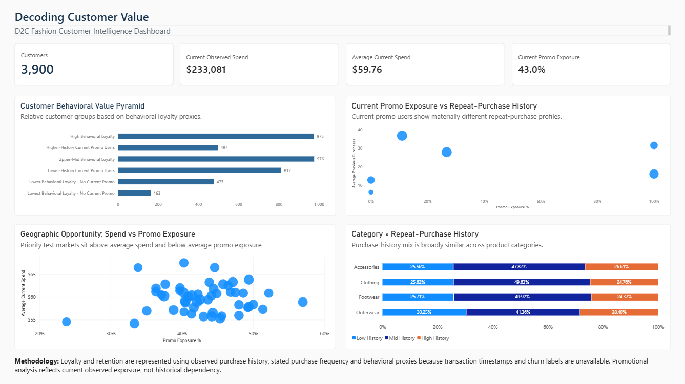

# Decoding Customer Value

A customer analytics project that turns a 3,900-customer D2C fashion snapshot into behavioral segments, Power BI decision tools, and an experiment-ready commercial strategy.

## Business Problem

A D2C retailer needs to distinguish customers with strong repeat-purchase signals from customers currently buying with promotions—without assuming that higher spend means stronger loyalty or that every current promo user should receive the same treatment.

The project connects customer behavior, Current Observed Spend, Observed Promo Exposure, geography, and category context to support practical targeting and testing decisions.

## Key Questions

- Which customers show the strongest Behavioral Loyalty Proxy signals?
- What separates higher- and lower-history current promo users?
- Does Current Observed Spend meaningfully distinguish behavioral groups?
- Where can geography support controlled market tests?
- How should the business selectively test promotional reduction?
- What observable signals define a useful Behavioral ICP?

## Approach

```text
Python                  SQL                    Power BI                Strategy
Audit and cleaning  ->  Business queries  ->  Decision dashboard  ->  Test and action plans
Feature engineering     Analytical views      Four business panels    Behavioral ICP
Proxy frameworks        Stakeholder access    Interactive reporting   30/60/90 roadmap
Segmentation and QA
```

## Key Findings

- **Repeat behavior separates customers more than basket size.** Average Repeat-Purchase History ranges from 6.5 to 36.6 across the six segments, while average Current Observed Spend remains within $59.24–$60.93.
- **Current promo users are heterogeneous.** Higher-History Current Promo Users average 31.4 previous purchases, compared with 16.2 for Lower-History Current Promo Users, despite nearly identical Current Observed Spend.
- **Blanket promotional removal is not supported.** Observed Promo Exposure is a current snapshot indicator, so promotional reduction requires randomized treatment and control groups.
- **Geography offers test cells, not proven growth markets.** State-level variation can guide matched experiments, but the dataset does not measure market size, acquisition economics, or trends.
- **Category differences are modest.** Average Repeat-Purchase History varies only from 25.0 to 25.7 across the four observed categories.

## Dashboard

The Power BI dashboard presents four decision-oriented panels:

1. **Customer Behavioral Value Pyramid** — compares six customer groups using Repeat-Purchase History, Current Observed Spend, and Observed Promo Exposure.
2. **Current Promo Exposure vs Repeat-Purchase History** — shows why current promo users require different treatments.
3. **Geographic Opportunity** — supports matched market testing using state-level behavioral and commercial context.
4. **Category × Purchase History** — compares category scale and repeat-purchase depth without overstating category effects.

[](PowerBI/Decoding_Customer_Value.png)

Open the final [Power BI report](PowerBI/Decoding_Customer_Value.pbix) or the version-controlled [PBIP project](PowerBI/Decoding_Customer_Value.pbip).

## Strategic Recommendations

- **Test a selective promo sunset:** begin with Higher-History Current Promo Users, retain a randomized control, and expand only if performance is non-inferior and guardrails remain stable.
- **Use a Behavioral ICP:** prioritize Repeat-Purchase History, stated purchase frequency, and satisfaction; use Current Observed Spend as a secondary commercial signal.
- **Run geographic experiments:** use adequately sized, comparable locations as test and control cells rather than treating observed differences as guaranteed opportunities.
- **Improve longitudinal tracking:** capture transaction timestamps, promotion type and discount depth, gross margin, acquisition source, customer acquisition date, and order-level category.

## Tech Stack

- **Python:** pandas, NumPy, data preparation, segmentation, and validation
- **SQL:** stakeholder-ready customer, segment, promotion, geography, category, and engagement analysis
- **Power BI:** semantic model, interactive dashboard, and final PBIX/PBIP delivery
- **Analytical QA:** customer-count reconciliation, identifier preservation, range checks, segment coverage, and output validation

## Repository Structure

```text
Decoding_Customer_Value/
├── Python/          # Reproducible analytical pipeline
├── SQL/             # Eight business-analysis queries
├── Outputs/
│   ├── analytical/  # Eight canonical analytical CSVs
│   └── dashboards/  # Five Power BI-ready extracts
├── PowerBI/         # PBIX, PBIP project, and dashboard preview
├── Strategy/        # Executive summary and action plans
├── Documentation/   # Methodology, findings, and QA
├── Presentation/    # Final PPTX and PDF
├── Raw_Data/        # Source and cleaned data
└── Archive/         # Documented noncanonical outputs
```

## Methodological Limitations

This is a customer-level cross-sectional snapshot with no transaction timestamps, churn labels, or historical order-level records. It cannot measure actual retention, customer departure, customer lifetime value, or customer-level promotional patterns over time. Observed associations do not establish causal effects, and stated purchase frequency is not transaction-derived.

The Behavioral Loyalty Proxy and Commercial Value Proxy are analytical prioritization tools—not longitudinal customer outcomes.

## How to Run

From the repository root:

```bash
python -m pip install -r requirements.txt

python Python/01_audit.py
python Python/02_clean.py
python Python/03_features.py
python Python/04_loyalty_definition_a.py
python Python/05_loyalty_definition_b.py
python Python/06_compare_loyalty.py
python Python/07_segmentation.py
python Python/08_geography.py
python Python/09_category.py
python Python/10_dashboards.py
python Python/11_validation.py
```

Run the scripts in order. They regenerate derived outputs and documentation; `Raw_Data/Dataset.csv` must remain unchanged.

## Deliverables

- **Analysis:** [canonical analytical outputs](Outputs/analytical/) and [analytical findings](Documentation/11_Analytical_Findings.md)
- **Strategy:** [executive summary and implementation plans](Strategy/)
- **Dashboard:** [Power BI report](PowerBI/Decoding_Customer_Value.pbix), [PBIP project](PowerBI/Decoding_Customer_Value.pbip), and [preview](PowerBI/Decoding_Customer_Value.png)
- **Presentation:** [final PPTX](Presentation/Decoding_Customer_Value_Final.pptx) and [PDF](Presentation/Decoding_Customer_Value_Final.pdf)
- **Quality assurance:** [project QA summary](Documentation/12_Project_QA_Summary.md)
